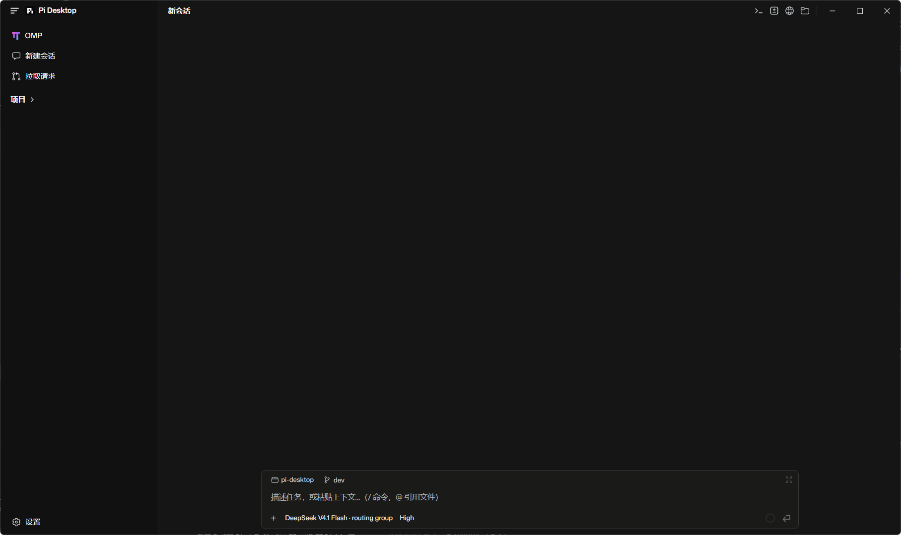

<div align="center">


# Pi Desktop

**The desktop agent workbench for [Pi](https://github.com/earendil-works/pi) and [OMP](https://github.com/can1357/oh-my-pi)**

[中文说明](./README.zh-CN.md) · [Releases](https://github.com/ImYoyoData/pi-desktop/releases) · [Issues](https://github.com/ImYoyoData/pi-desktop/issues)

<br />

<a href="https://github.com/ImYoyoData/pi-desktop/releases">
  
</a>
<a href="https://github.com/ImYoyoData/pi-desktop/stargazers">
  
</a>
<a href="https://github.com/ImYoyoData/pi-desktop/forks">
  
</a>
<a href="https://github.com/ImYoyoData/pi-desktop/issues">
  
</a>
<a href="https://github.com/ImYoyoData/pi-desktop/blob/dev/LICENSE">
  
</a>
<a href="https://github.com/ImYoyoData/pi-desktop">
  
</a>
<a href="https://www.electronjs.org/">
  
</a>
<a href="https://react.dev/">
  
</a>
<a href="https://github.com/ImYoyoData/pi-desktop">
  
</a>

<br /><br />

```text
┌───────────────────┬──────────────────────┬───────────────────┐
│ Sessions · Models │ Agent streaming chat │ Files · Changes   │
│ Skills · Todos    │ Tools · Ask user     │ Browser · Preview │
│ Engine Pi / OMP   │ Quoted screenshots   │ Terminal (bottom) │
└───────────────────┴──────────────────────┴───────────────────┘
```

</div>

---

<h2 align="center">Screenshots</h2>

<p align="center">
  
</p>

---

### Why Pi Desktop?

- Drives agents with the Pi SDK directly, without an RPC bridge to the CLI
- Switch between the Pi and OMP (oh-my-pi) engines in one window, each with its own config directory and sessions
- Actively maintained

| Layer | What it provides |
| --- | --- |
| **Agent core** | Multi-session Pi / OMP runtimes, streaming turns, tool cards with diffs, ask_user wizard, skills and slash commands, session-level todo list |
| **Workbench** | Files / Changes / Browser right pane, bottom terminal, Markdown preview (edit / split / preview) and a full Git panel (branches, staging, commit, push, history) |
| **Trust & safety** | Project trust gate; tools run with the app's own OS permissions |
| **Release pipeline** | A push to main builds NSIS (x64 / arm64), DMG (Apple Silicon / Intel) and AppImage (x64) and publishes a Release |

---

## Getting started

### Download

Get the latest installer from [Releases](https://github.com/ImYoyoData/pi-desktop/releases): Windows x64 / arm64, macOS Apple Silicon / Intel, Linux x64 (AppImage).

### Build from source

Requires Node.js 24+.

```bash
npm install        # install dependencies
npm run typecheck  # typecheck main + renderer
npm run dugite:git # fetch the embedded Git binary (optional; Git panel needs it)
npm run dev        # run in development
npm run build      # build
npm run dist       # package for the current platform
```

## Interface languages

English, Simplified Chinese, Traditional Chinese and Japanese.

## License

[MIT](./LICENSE)
