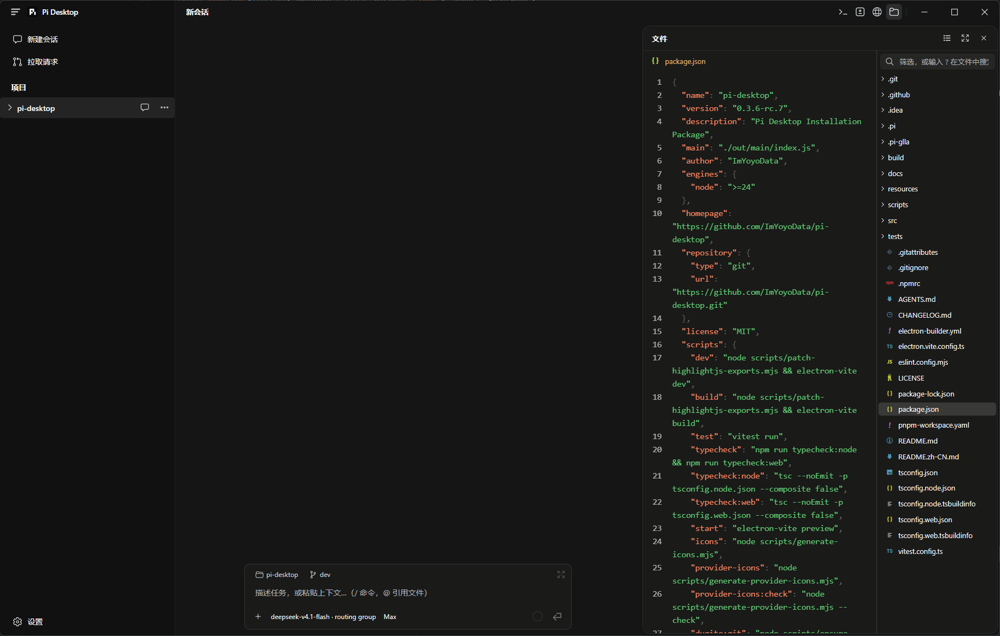

# Pi Desktop

**A desktop workbench for [Pi](https://github.com/badlogic/pi-mono) coding agents** — multi-session chat, live tool streaming, embedded browser, terminal, file preview and a full Git panel in one Electron window.

[中文说明](./README.zh-CN.md) · [Releases](https://github.com/ImYoyoData/pi-desktop/releases) · [Issues](https://github.com/ImYoyoData/pi-desktop/issues)

 

  

## Screenshots

**Chat workbench** — run a task and watch the agent think, call tools and stream results in real time:

## License

[MIT](./LICENSE)
