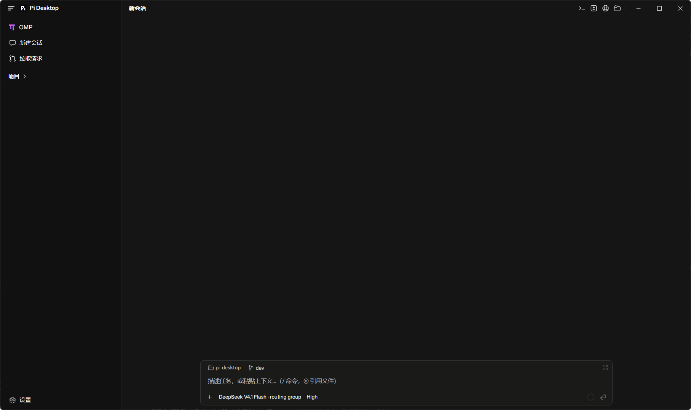

<div align="center">


# Pi Desktop

**[Pi](https://github.com/earendil-works/pi) 与 [OMP](https://github.com/can1357/oh-my-pi) 的桌面Agent工作台** 

[English](./README.md) · [Releases](https://github.com/ImYoyoData/pi-desktop/releases) · [Issues](https://github.com/ImYoyoData/pi-desktop/issues)

<br />

<a href="https://github.com/ImYoyoData/pi-desktop/releases">
  
</a>
<a href="https://github.com/ImYoyoData/pi-desktop/stargazers">
  
</a>
<a href="https://github.com/ImYoyoData/pi-desktop/forks">
  
</a>
<a href="https://github.com/ImYoyoData/pi-desktop/issues">
  
</a>
<a href="https://github.com/ImYoyoData/pi-desktop/blob/dev/LICENSE">
  
</a>
<a href="https://github.com/ImYoyoData/pi-desktop">
  
</a>
<a href="https://www.electronjs.org/">
  
</a>
<a href="https://react.dev/">
  
</a>
<a href="https://github.com/ImYoyoData/pi-desktop">
  
</a>

<br /><br />

```text
┌───────────────┬──────────────────────┬──────────────────┐
│ 会话 · 模型   │ Agent 流式对话       │ 文件 · 更改      │
│ 技能 · 待办   │ 工具 · 询问用户      │ 浏览器 · 预览    │
│ 引擎 Pi / OMP │ 引用截图             │ 终端（底部）     │
└───────────────┴──────────────────────┴──────────────────┘
```

</div>

---

<h2 align="center">截图</h2>

<p align="center">
  
</p>

---

### 为什么选择 Pi Desktop？

- 直接使用 Pi SDK 驱动 Agent，不经过 CLI 的 RPC 桥接
- 同一窗口内可切换 Pi 与 OMP（oh-my-pi）两套引擎，配置目录与会话各自独立
- 开发者积极维护

| 分层 | 提供什么 |
| --- | --- |
| **Agent 核心** | 多会话 Pi / OMP 运行时、流式回合、带 Diff 的工具卡片、ask_user 向导、技能与斜杠命令、会话级待办清单 |
| **工作台** | 文件 / 更改 / 浏览器三页右栏、底部终端、Markdown 预览（编辑 / 分栏 / 预览）与完整 Git 面板（分支、暂存、提交、推送、历史） |
| **信任与安全** | 项目信任门；工具以应用自身的操作系统权限执行 |
| **发布链路** | 推送到 main 自动构建 NSIS（x64 / arm64）、DMG（Apple Silicon / Intel）与 AppImage（x64）并发布 Release |

---

## 开始使用

### 下载

从 [Releases](https://github.com/ImYoyoData/pi-desktop/releases) 获取最新安装包：Windows x64 / arm64、macOS Apple Silicon / Intel、Linux x64（AppImage）。

### 源码构建

需要 Node.js 24+。

```bash
npm install        # 安装依赖
npm run typecheck  # 类型检查（主进程 + 渲染层）
npm run dugite:git # 下载内嵌 Git 二进制（可选；Git 面板需要）
npm run dev        # 开发运行
npm run build      # 构建
npm run dist       # 构建当前平台安装包
```

依赖安装阶段的下载（Electron 二进制、electron-builder 二进制）仍由 `.npmrc` 里的镜像键驱动；
npm 13 起不再读取这些键，需改用环境变量 `ELECTRON_MIRROR`、`ELECTRON_CUSTOM_DIR`、
`ELECTRON_BUILDER_BINARIES_MIRROR`。仓库自身的 `postinstall` 已先从 `.npmrc` 取值再调用
Electron 安装脚本，因此仓库内重装不受 npm 版本影响。

## 界面语言

支持简体中文、繁體中文、英语、日语

## 许可证

[MIT](./LICENSE)
